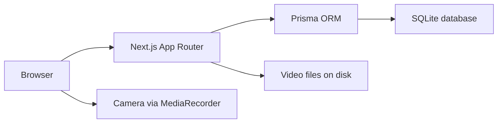

# Design: Dance Studio Pro

## Overview

Dance Studio Pro is a responsive web app where a User learns dance through tutorial videos, records themselves practicing with their camera, compares their recording side-by-side with the tutorial, and tracks their progress and achievements. There is a single role, the User, and no social feed: practice recordings stay private to the User who made them.

The app runs in the browser on mobile and desktop. It serves pages from a Next.js server, stores data in a SQLite database, and records practice video in the browser with the MediaRecorder API, so no video is uploaded to a third-party service.

## Architecture

A single Next.js (App Router) application serves both the pages and the API routes. The browser records practice video locally with `MediaRecorder` and uploads the resulting WebM file to the app, which stores it on disk. Tutorial videos are static files served by the app.

- **Pages** (server components + client components) render the screens.
- **API routes** under `src/app/api/` handle sign in/up, tutorials, recordings, favorites, schedules, progress and achievements.
- **Prisma** maps the data model to SQLite.
- **Auth** uses signed, httpOnly session cookies with password hashing (bcrypt).

## Components and Interfaces

### Screens

1. **Sign in / sign up** — the page at `/`. A person signs in with email and password, or signs up with name, email and password.
2. **Home** — lists the dance tutorials with category, level and search filters.
3. **Tutorial** — plays the tutorial video, shows step-by-step instructions, and offers slow-motion playback and a "Start practice" action.
4. **Practice session** — asks for camera permission, records the User, and plays the recording back side-by-side with the tutorial.
5. **Profile** — shows the User's name, level, favorite tutorials and practice schedule, and lets them edit each.
6. **Progress** — shows completed tutorials and total practice hours.
7. **Achievements** — shown on the profile; awarded automatically.

### API routes

| Route | Purpose |
| --- | --- |
| `POST /api/auth/signup` | Create a User and sign them in |
| `POST /api/auth/signin` | Sign a User in |
| `POST /api/auth/signout` | Sign a User out |
| `GET /api/tutorials` | List tutorials, filtered by category, level and search text |
| `GET /api/tutorials/[id]` | One tutorial with its steps |
| `POST /api/recordings` | Save a practice recording (multipart upload) |
| `GET /api/recordings/[id]` | Stream a recording back |
| `POST /api/tutorials/[id]/complete` | Mark a tutorial completed |
| `GET/PUT /api/profile` | Read and update the User's profile and level |
| `POST/DELETE /api/favorites/[id]` | Add or remove a favorite tutorial |
| `POST/DELETE /api/schedule/[id]` | Add or remove a practice session in the schedule |
| `GET /api/progress` | Completed tutorials and practice hours |
| `GET /api/achievements` | The User's achievements |

## Data Models

Prisma models in `prisma/schema.prisma`:

- **User** — `id`, `name`, `email` (unique), `passwordHash`, `level` (Beginner | Intermediate | Advanced), `createdAt`.
- **Tutorial** — `id`, `title`, `category` (Hip-Hop | Bollywood | Classical | Contemporary | Freestyle), `level`, `videoPath`, `steps` (ordered list of step instructions).
- **Recording** — `id`, `userId`, `tutorialId`, `filePath`, `durationSeconds`, `createdAt`.
- **Favorite** — `id`, `userId`, `tutorialId`.
- **ScheduleEntry** — `id`, `userId`, `tutorialId`, `scheduledAt`.
- **Completion** — `id`, `userId`, `tutorialId`, `completedAt`.
- **Achievement** — `id`, `userId`, `name`, `earnedAt`.

## Error Handling

- Sign-in with an unknown email or wrong password returns the message "Incorrect email or password".
- A denied camera permission shows "Camera access is needed to record your practice".
- API routes return JSON errors with a matching HTTP status; the client shows the message to the User.

## Testing Strategy

- **Unit tests** (Vitest) cover the API routes and the achievement-awarding rule, using a throwaway SQLite database per run.
- **End-to-end journeys** (Playwright) cover each screen as a User, saved under `e2e/` and run through `run_journeys`.

## Build and run
Install: npm install
Test: npm test
Run locally: yes
Dev: npm run dev
Port variable: PORT
Health path: /api/health
Deploy: none

## Test logins

- User — `dancer@example.com` / `password123`

## Look and feel

A clean, modern style suited to a dance app: dark, energetic surfaces with a vivid accent.

- **Background:** `#0f0f14`
- **Surface:** `#1a1a22`
- **Text:** `#f5f5f7`
- **Primary:** `#ff3d71`
- **Error:** `#ff5252`
- **Success:** `#2ecc71`
- **Font:** system-ui stack (`-apple-system, "Segoe UI", Roboto, sans-serif`)
- **Spacing:** 4px base scale (4, 8, 12, 16, 24, 32)
- **Corner radius:** 12px on cards and buttons, 8px on fields

**Buttons:** primary buttons use the primary colour with white text; secondary buttons use a transparent background with a 1px border. Hover darkens the primary colour; focus shows a 2px outline in the primary colour; pressed shifts the button down 1px; disabled buttons are 40% opacity and not clickable.

**Fields:** dark surface with a 1px border, rounded 8px; focus shows a 2px primary outline.

**Lists:** cards on the surface colour with 12px radius, separated by 12px gaps.

### Screen layouts

- **Sign in / sign up:** a centered card on both phone and desktop, with the app name above the fields.
- **Home:** a top bar with the app name and the User's avatar; below it a search field and a row of category chips and level chips; then a grid of tutorial cards (one column on phone, three on desktop).
- **Tutorial:** the video player full-width at the top, the title/category/level below it, then the step-by-step instructions, and a "Start practice" button.
- **Practice session:** the camera preview and the tutorial video side-by-side (stacked on phone, two columns on desktop), with record/stop and playback controls.
- **Profile:** the User's name and level at the top, then favorite tutorials and the practice schedule as two lists.
- **Progress:** two large stat cards (completed tutorials, practice hours) at the top, then the list of completed tutorials.
